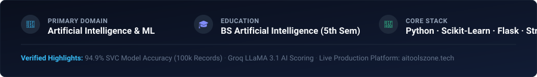

 

  

---

### Introduction

I am an **Artificial Intelligence & Machine Learning Student** and **Python Developer** pursuing my BS in Artificial Intelligence (5th Semester).

My work focuses on bridging statistical machine-learning pipelines with functional, production-oriented software architectures. Rather than isolated notebook experiments, I engineer end-to-end applications: pairing predictive classification algorithms (Support Vector Machines), large language model inference (Groq LLaMA 3.1), and computer vision classifiers with interactive web frameworks (Streamlit, Flask) and automated static workflows.

---

### About Me

- **Education & Applied Focus:** Undergraduate in Artificial Intelligence, concentrating on supervised predictive modeling, data analysis, and intelligent web applications.
- **Applied Machine Learning:** Experienced in architecting end-to-end ML workflows — from exploratory data analysis and categorical encoding to model training, hyperparameter evaluation, and serialization for live inference.
- **Python & Web Systems:** Strong foundations in Python (Flask, Streamlit), RESTful API development, structured JSON schema generation, and frontend integration with HTML5 and CSS3.
- **Production & Tooling:** Creator of **AI Tools Zone** (`aitoolszone.tech`), utilizing static site generation, automated SEO telemetry pipelines, and continuous deployment via GitHub Actions.
- **Engineering Philosophy:** Prioritizing empirical accuracy, observable model behavior, clean dependency management, and reproducible codebases over speculative prototypes.

---

### Featured Engineering Projects

#### 1. Diabetes Risk Prediction System
*End-to-End Clinical Classification Pipeline & Dual Interactive Dashboards* · [Repository](https://github.com/su92-bsaim-f24-127-hue/Diabetes_prediction)

- **Problem & Solution:** Clinical diabetes screening requires reliable, rapid evaluation of multi-indicator patient health profiles to identify at-risk individuals before symptom onset. This system provides automated, data-driven diabetes risk classification.
- **Engineering Highlights:**
  - **High-Precision Model:** Trained a **Support Vector Classifier (SVC)** utilizing an RBF kernel, achieving a verified **94.9% test accuracy** across 100,000 patient records.
  - **Preprocessing Architecture:** Executed exploratory data analysis, label encoding for demographic variables (`gender`, `smoking_history`), and structured feature scaling across 8 clinical indicators (`HbA1c_level`, `blood_glucose_level`, `bmi`, `hypertension`, `heart_disease`, `age`).
  - **Dual Deployment Interfaces:** Implemented an exploratory **Streamlit** dashboard (`app.py`) for visual risk diagnosis alongside a lightweight **Flask** web application (`app2.py`) for API-driven prediction.
  - **Verification & CI:** Full workflow validated in `project.ipynb`; automated smoke tests in `tests/test_smoke.py` run on **GitHub Actions CI**.
- **Tech Stack:** `Python` · `Scikit-Learn` · `SVC (RBF)` · `Pandas` · `NumPy` · `Streamlit` · `Flask` · `GitHub Actions`

---

#### 2. AI Interview Preparation System
*LLM-Powered Technical Interview Coach & Automated Evaluation Engine* · [Repository](https://github.com/su92-bsaim-f24-127-hue/AI_interview_prepration_system)

- **Problem & Solution:** Aspiring machine learning engineers often lack structured, objective feedback when practicing technical interview questions. This interactive platform simulates real interview drills with instant, quantitative AI critique.
- **Engineering Highlights:**
  - **Low-Latency LLM Inference:** Integrated the **Groq Cloud API** running `llama-3.1-8b-instant`, achieving sub-second answer scoring without heavy GPU overhead.
  - **Strict JSON Evaluation:** Designed system prompt boundaries forcing the model to return typed JSON output grading answers (0-10 score), summarizing strengths, detecting technical gaps, and offering tactical tips.
  - **Flexible Practice Modes:** Features categorized browsing by topic and difficulty tiers (Easy, Medium, Hard), randomized quiz drills, contextual hints without revealing answers, and CSV dataset uploads with automated schema validation.
  - **Test Suite & Automation:** Validated test coverage with **Pytest** and continuous integration testing via **GitHub Actions**.
- **Tech Stack:** `Python` · `Flask` · `Groq Cloud SDK` · `LLaMA 3.1` · `Pandas` · `REST API` · `HTML5 / CSS3` · `Pytest`

---

#### 3. AI Tools Zone
*Curated AI Subscriptions Marketplace & Automated SEO Platform* · [Live Platform](https://aitoolszone.tech/) · [Repository](https://github.com/su92-bsaim-f24-127-hue/ai-tools-zone)

- **Problem & Solution:** Navigating modern AI subscription plans in Pakistan involves localized payment hurdles and fragmented product comparison. AI Tools Zone serves as a centralized digital catalog and direct ordering hub.
- **Engineering Highlights:**
  - **Static Site Engine:** Engineered a custom Python static site generator (`build_site.py`) compiling 20+ tool catalog entries into high-performance static HTML with zero runtime framework overhead.
  - **Automated Telemetry & SEO:** Integrated automated weekly telemetry workflows, sitemap generation, OpenGraph metadata, and Schema.org JSON-LD structured markup.
  - **Interactive Features:** Includes real-time catalog search, multi-category filtering, tool comparison tables, persistent light/dark themes, and direct WhatsApp order generation.
  - **Production Deployment:** Deployed via **GitHub Pages** with custom domain DNS mapping (`aitoolszone.tech`).
- **Tech Stack:** `Python (SSG Engine)` · `HTML5` · `CSS3` · `JavaScript` · `GitHub Actions` · `SEO Automation` · `Live Production`

---

#### 4. Multimodal AI & Computer Vision Labs
*Practical Artificial Intelligence Laboratory Suite (14 Modules)* · [Repository](https://github.com/su92-bsaim-f24-127-hue/Fall25-PAI-Lab)

- **Problem & Solution:** Hands-on university laboratory implementations investigating foundational to modern AI paradigms across 14 modular projects.
- **Engineering Highlights:**
  - **Computer Vision (Lab 6):** Real-time facial detection web application using **OpenCV** Haar Cascade classifiers (`haarcascade_frontalface_default.xml`) integrated with Flask.
  - **Classical State-Space Search (Lab 3):** Solved the classic Water Jug Problem utilizing Depth-First Search (DFS) state space traversal.
  - **Conversational Health Bot (Labs 10 & 12):** Built **FitnessBot**, an automated conversational assistant for workout recommendations and health guidance.
  - **Data Scraping (Lab 1):** Built an automated web extraction pipeline using BeautifulSoup and Requests with Excel export functionality.
- **Tech Stack:** `Python` · `OpenCV` · `Flask` · `Scikit-Learn` · `BeautifulSoup` · `Jupyter Notebooks`

---

#### 5. Autonomous Reflex & Problem-Solving Agents
*Foundational AI Agent Architectures & Heuristic Traversals* · [Repository](https://github.com/su92-bsaim-f24-127-hue/-Fall25-AI-Lab-)

- **Problem & Solution:** Implementation of classical intelligent agent designs exploring internal state representations and search heuristics.
- **Engineering Highlights:**
  - **Memory-Based Reflex Agent (Task 3):** Engineered an autonomous agent utilizing a persistent internal state file (`memory.txt`) to guide perception-action cycles based on prior history.
  - **Uninformed Search (Lab 5):** Evaluated tree expansion, node visiting order, and cycle detection using Depth-First Search algorithms.
  - **Game State Logic (Lab 1 & 2):** Implemented adversarial board state evaluation for classic games including Tic-Tac-Toe.
- **Tech Stack:** `Python` · `AI Agent Architectures` · `Tree Search Algorithms` · `State Representation`

---

### Technical Expertise

| Domain | Technologies & Methodologies |
|---|---|
| **AI & Machine Learning** | Scikit-Learn, Support Vector Machines (SVC), OpenCV, Exploratory Data Analysis (EDA), Model Evaluation, Pickle |
| **Generative AI & LLMs** | Groq Cloud API, LLaMA 3.1, Prompt Engineering, Structured JSON Schemas, REST Inference |
| **Backend & Web Engineering** | Python, Flask, Streamlit, RESTful APIs, Jinja2 Templates, Form Validation, Static Site Generators (SSG) |
| **Data Analysis & Scientific** | Pandas, NumPy, Data Cleaning, Categorical Label Encoding, Feature Selection, Excel/CSV Pipelines |
| **Developer Tools & CI/CD** | Git, GitHub, GitHub Actions, Pytest, VS Code, Jupyter Notebooks, Windows PowerShell |
| **Frontend & Styling** | HTML5, CSS3, Vanilla JavaScript, Responsive Design, Tokyo Night / Slate Aesthetics |

---

### Engineering Journey

- **Foundations in Computing & Python**  
  Algorithmic problem solving, object-oriented programming, data structures, and numerical data manipulation with Python and Pandas.

- **Statistical Machine Learning & Clinical Prediction**  
  Supervised classification, train-test validation splits, feature matrix encoding, and model training using Support Vector Classifiers (SVC).

- **Generative AI & LLM Systems**  
  Interfacing with cloud LLM inference engines (Groq LLaMA 3.1), designing structured output evaluations, and building interactive web tools.

- **Product Delivery & Full-Stack Systems**  
  Engineering complete digital platforms (AI Tools Zone), automating build workflows with GitHub Actions CI, and deploying live production platforms.

---

### Currently Building & Exploring

- **Deep Learning Architectures:** Deepening practical implementations of Convolutional Neural Networks (CNNs) and PyTorch foundations.
- **Retrieval-Augmented Generation (RAG):** Designing evidence-grounded retrieval systems using vector search and embedding similarity.
- **MLOps & Containerization:** Exploring Docker containerization and model serving pipelines for reproducible AI deployments.

---

### GitHub Activity & Analytics

 

---

### Connect & Profiles

- **Email:** [abdul1234light@gmail.com](mailto:abdul1234light@gmail.com)
- **Portfolio:** [aitoolszone.tech](https://aitoolszone.tech/)
- **GitHub:** [github.com/su92-bsaim-f24-127-hue](https://github.com/su92-bsaim-f24-127-hue)
- **Academic Focus:** BS Artificial Intelligence, 5th Semester
- **Location:** Pakistan
